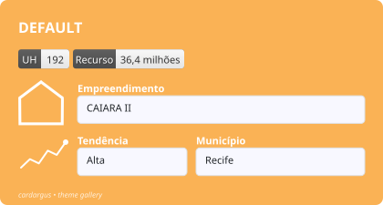
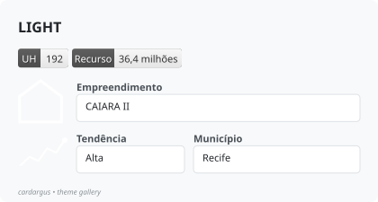
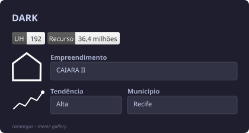
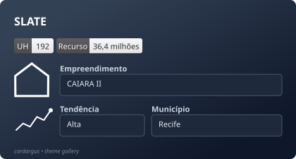
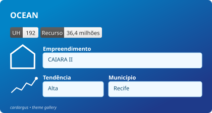
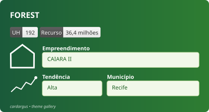
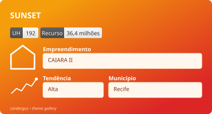
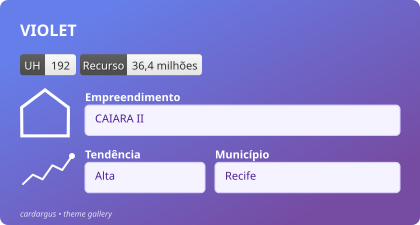

# Theme Gallery

cardargus ships with eight preset themes. Apply one with the `theme` argument
of `svg_card()`, list them with `card_themes()`, and customize any component
with `card_theme()` — arguments set explicitly in the call always win over the
theme.

Every card below was produced by the same call, varying only `theme`:

```python
import cardargus as c

badges = [
    {"label": "UH", "value": "192"},
    {"label": "Recurso", "value": "36,4 milhões"},
]

fields = [
    [{"label": "Empreendimento", "value": "CAIARA II", "with_icon": True}],
    [
        {"label": "Tendência", "value": "Alta",
         "with_icon": c.create_sparkline([2, 4, 3, 6, 5, 8], width=55, height=34)},
        {"label": "Município", "value": "Recife"},
    ],
]

svg = c.svg_card(
    "DARK",                      # one card per theme below
    badges,
    fields,
    theme="dark",
    width=420,
    footer="cardargus • theme gallery",
)
c.save_svg(svg, "theme-dark.svg", subset_fonts=True)
```

The images are self-contained SVGs with the Jost font embedded
(`subset_fonts=True`), exactly as `save_svg()` produces them.

## default



## light



## dark



## slate



## ocean



## forest



## sunset



## violet



## Customizing a preset

```python
# Per call: explicit arguments beat the theme
c.svg_card("ALERT", badges, fields, theme="dark", bg_color="#e74c3c")

# Reusable: tweak a preset once, use it everywhere
my_theme = c.card_theme("ocean", footer_color="#cceeff", font="Montserrat")
c.svg_card("REPORT", badges, fields, theme=my_theme)
```
